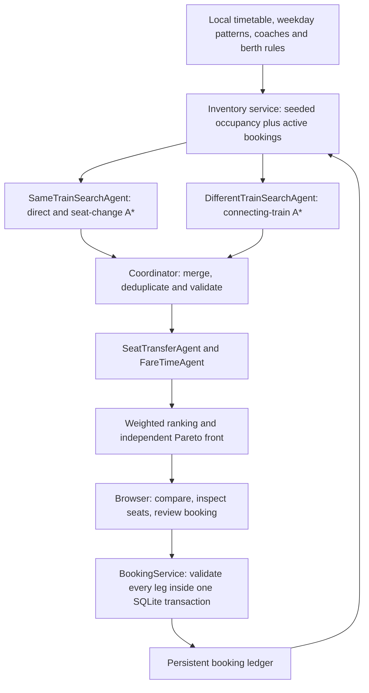

# SplitRail

SplitRail is an academic multi-agent train journey and split-ticket booking
simulation. It searches historical local timetables, assigns deterministic
physical seats across route segments, compares direct journeys with seat or
train changes, and persists simulated reservations.

**This is a simulated railway booking environment. It does not purchase real
railway tickets, issue real PNRs, take payments, or report live availability.**

## Run

Use Python 3.11 or newer:

```sh
cd split-ticket-train-booking
python3 -m venv .venv
source .venv/bin/activate
pip install -r requirements.txt
python web.py
```

Open **http://localhost:8000**. The frontend is plain HTML/CSS/JavaScript;
there is no npm build. `--port 8001` selects another port, and `--db PATH`
selects a reference database. `--offline` is retained for compatibility;
bookable searches always use local data. No API key is needed.

Startup builds or refreshes the reference database for a ten-day window.
The default ledger, `split-ticket-train-booking/bookings.db`, survives restarts
and reference rebuilds. `SPLIT_TICKET_BOOKINGS_DB` selects a separate ledger.
Restart a server left open overnight to advance its window.

The local installation has **8,990 station records and 5,208 train records**.
The website searches **Kerala only: 177 station records and 265 train services**.
This includes all 87 originally Kerala-tagged records plus 90 existing records
with corrected missing state labels (including KYJ and PGT). **167 stations**
have usable halt records; the other ten are visibly marked unavailable.
All 83 usable stations from the original 87 have inventory coverage.
Coach layouts and operating days added for coverage are explicitly simulated;
train numbers, routes and times remain historical local records.
The committed Kerala timetable extract supports a portable build. The larger
reference archive does not imply bookable nationwide coverage.

## How the agents find tickets



These are specialist software agents with explicit responsibilities, not
LLMs. Two process workers can search independently; the coordinator handles
constraints and the final recommendation.

1. Validate station codes, boarding date, class, passengers and transfer limit.
2. Derive each train's origin run date from its ordered stop's journey-day offset.
   Check that run against the local weekday calendar.
3. Expand a graph edge only when real ordered halts, usable timetable values,
   coaches and segment inventory support the ticket. A split requires confirmed
   seats on every leg. Seat changes need a five-minute halt; train changes need
   twenty minutes. Both thresholds are configured centrally.
4. A* collects candidate journeys using moving minutes as its search cost.
   The reverse-Dijkstra station-graph heuristic ignores inventory and transfers,
   giving a lower bound on that same moving-time objective.
5. Score fare, elapsed time, waiting/dwell, coach distance and nighttime changes.
   Rank with configurable weights and identify nondominated alternatives.
6. Return structured legs, actual allocated seat numbers, train run dates,
   journey types, scores, search effort and eligibility for simulated booking.

A* is bounded and uses representative seat allocations. It does not enumerate
every possible seat combination or guarantee the globally best weighted
recommendation. Results are grouped by train and run date: each train shows
its direct availability, seat-change options and onward connections together.
All supported direct services appear, including those with no confirmed seat. See [architecture](docs/architecture.md).

## Booking consistency

A physical seat is identified by **train + origin run date + coach + seat number**.
Its occupancy is a bit mask over consecutive real halt segments. Booking A→B
blocks overlapping spans; B→C can reuse the seat if that span is free.

Initial occupancy is generated from a fixed, versioned SHA256 seed and valid
local route/layout records. Searches never invent random request-time seats.
The default busy-v2 profile leaves only 1–4 free seats per coach and segment,
with reproducible scarce-through, fragmented and fully occupied demand tiers.
Fragment boundaries use real halts of at least five minutes; full direct seats
and valid seat-change alternatives emerge from the same general search.
Existing booked runs retain their original seed through a backed-up migration.
Active SQLite reservations overlay that seed. Search, direct listings,
availability checks and booking all use `InventoryService`.

`BEGIN IMMEDIATE` serializes competing allocation checks. Every leg of a split
commits together or all roll back. The server rechecks seats and calculates
fares; client prices are ignored. Cancellation retains history and releases
only that leg's occupied segments. Existing count-only bookings are preserved
with conservative capacity consumption and labelled unassigned in history.

## Demonstration

From `split-ticket-train-booking`, run the automated acceptance scenario:

```sh
.venv/bin/python tools/demo_acceptance.py
```

It uses a temporary ledger, discovers a busy train with a valid seat change,
tests KYJ→PGT, ALLP→PGT and TVC→CAN, books, rejects an overlapping duplicate,
reopens the database, and cancels. It does not change your reservations.

For a repeatable browser presentation, create an isolated reference and ledger:

```sh
DEMO_DIR=$(mktemp -d /tmp/splitrail-demo.XXXXXX)
SPLITRAIL_WINDOW_START=2026-10-09 .venv/bin/python data_source/build_sqlite_db.py "$DEMO_DIR/railway.db" --operational-only
SPLITRAIL_WINDOW_START=2026-10-09 SPLIT_TICKET_BOOKINGS_DB="$DEMO_DIR/bookings.db" .venv/bin/python web.py --db "$DEMO_DIR/railway.db" --port 8000
```

1. Search **Kayamkulam (KYJ) → Palakkad (PGT)**, **9 October 2026**, **SL**, one
   passenger, one transfer, seat changes allowed.
2. Compare train groups. Each shows direct inventory and any seat-change or
   connecting-train alternatives underneath; expand more options when needed.
3. In a fresh busy-v2 ledger, **12625 Kerala Express** has no through SL seat.
   Search finds **KYJ 12:55 → Kottayam (KTYM) 14:05, S1 seat 15**, followed by
   **KTYM 14:10 → PGT 18:35, S1 seat 2**. These are seats on the same train run.
   This is a discovered example, not a special-case route or guaranteed live service.
4. Review and confirm the simulated booking. Record the `SIM-` reference and seats.
5. Search again: those allocations are occupied on their booked spans. Restart
   using the same ledger path to show persistence. Cancel a leg in My Bookings
   to release that leg; cancelled records remain visible.
6. Repeat with **Alappuzha (ALLP) → Palakkad** and **Thiruvananthapuram (TVC) → Kannur (CAN)**.

To reset a presentation, create another fresh directory with the same commands.
Do not delete your existing ledger. Reference rebuilds create a `.pre-rebuild.bak`
backup before atomic replacement; legacy ledger migrations create a
`.pre-seats.bak` backup before adding seat fields. The busy-profile migration
creates `.pre-busy.bak` and preserves original inventory for historically booked runs.

To regenerate the deterministic Kerala configurations and exact timetable extract:

```sh
.venv/bin/python data_source/generate_kerala_simulation.py
```

`SPLITRAIL_REGION=Kerala`, `SPLITRAIL_NETWORK_PROFILE=kerala-v1` and
`SPLITRAIL_INVENTORY_PROFILE=busy-v2` are defaults. The academic baseline suite
explicitly pins `ALL`, `legacy` and `standard-v1` for its historical comparisons;
production Kerala coverage and the busy profile have separate integration tests.
Inventory profile defaults are persisted per ledger; environment changes do not
silently reseed existing reservations.

## Tests and evidence

```sh
.venv/bin/python -m pytest -q -rs
.venv/bin/python -m pip install 'ruff==0.15.3'
.venv/bin/ruff check .
node --check web/app.js
.venv/bin/python -m compileall -q src web.py cli.py tools
.venv/bin/python tools/benchmark_search.py
```

Optional browser verification uses Playwright and installed Google Chrome:

```sh
.venv/bin/python -m pip install playwright
.venv/bin/python tools/check_browser.py /tmp/splitrail-browser
```

See [validation results](docs/validation.md), [initial audit](docs/implementation-audit.md),
[architecture and algorithms](docs/architecture.md), and [data provenance](split-ticket-train-booking/README.md).

## Limits and academic assumptions

- Timetables are historical local records. Operating patterns and expanded coach
  layouts contain documented simulation assumptions and are not live-verified.
- Seats and initial occupancy are reproducible simulated inventory. RAC and
  waitlist are unallocated advisory statuses; this prototype books confirmed
  physical seats only and does not implement queue promotion.
- Fares are deterministic estimates, not official tariffs. Travel times are
  scheduled times in local railway time; delays and platform access are not modelled.
- Same-train search allows one seat change; different-train search allows up to
  two changes with pruning. Mixed seat-change/train-change journeys are not generated.
  Connections consider the arrival date and following day, within a four-day horizon.
- The UI handles one to six passengers; group members receive specific seats in
  a coach but adjacency and berth preference are not guaranteed.
- This localhost demo has a shared booking history and no authentication, payment,
  real railway integration or production service deployment. Engine requests are
  serialized; only independent searches within a request run in separate processes.
